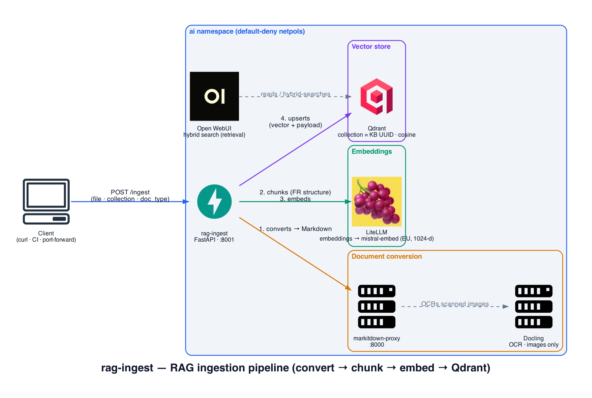

# minicloud-rag-ingest

[](https://github.com/andrelair-platform/minicloud-rag-ingest/actions/workflows/ci.yml)
[](LICENSE)
[](https://github.com/sigstore/cosign)
[](https://www.python.org)
[](https://fastapi.tiangolo.com)

> A cluster-native RAG ingestion pipeline deployed as a Kubernetes service. Accepts any document, converts it to Markdown, splits it on French insurance structural boundaries, embeds each chunk, and upserts it directly into a Qdrant vector collection — with no local tools required.

---

## Table of Contents

- [Why this exists](#why-this-exists)
- [Architecture](#architecture)
- [API](#api)
- [Document types](#document-types)
- [Chunking logic](#chunking-logic)
- [Running locally](#running-locally)
- [Ingesting a document from the Mac](#ingesting-a-document-from-the-mac)
- [CI/CD pipeline](#cicd-pipeline)
- [Environment variables](#environment-variables)
- [Security](#security)
- [Troubleshooting](#troubleshooting)
- [Related services](#related-services)
- [License](#license)

---

## Why this exists

The Open WebUI paperclip upload path converts and embeds documents inside the UI container using whatever embedding model is configured globally. This creates three problems for a domain-specific French insurance RAG use case:

1. **No structural awareness** — documents are split by character count, not by article or section boundaries. A clause that spans two chunks loses its legal context.
2. **No metadata tagging** — chunks have no `doc_type`, `section`, or `article` fields, making targeted retrieval impossible.
3. **Mac-side dependency** — running the ingestion pipeline locally requires local Python, local DB access, and local credentials.

`rag-ingest` solves all three. It runs in the `ai` namespace alongside the rest of the platform, accepts a simple `multipart/form-data` POST, and handles the entire pipeline in-cluster: convert → chunk → embed → store.

---

## Architecture



> **Pipeline:** `POST /ingest` → **1.** convert to Markdown (markitdown-proxy; scanned images via Docling OCR) → **2.** structure-aware chunk (FR legal boundaries) → **3.** embed via LiteLLM → **4.** **upsert into Qdrant** (collection = the Open WebUI Knowledge Base UUID; cosine; payload = `{text, document_type, section, article, source}`). Open WebUI then hybrid-searches that collection at retrieval time. Solid = principal flow · dashed = backing dependency.
>
> _Diagram is generated — `docs/diagrams/rag_ingest_pipeline.py` (mingrammer `diagrams` + Graphviz); edit the script, not the image._

**In-cluster DNS names used at runtime:**

| Dependency | Address | Source |
|---|---|---|
| markitdown-proxy | `http://markitdown-proxy.ai.svc.cluster.local:8000` | [`minicloud-markitdown-proxy`](https://github.com/andrelair-platform/minicloud-markitdown-proxy) — custom service |
| LiteLLM (embeddings) | `http://litellm.ai.svc.cluster.local:4000` | Helm — `platform/ai/litellm/` in minicloud-gitops |
| Qdrant (vector store) | `http://qdrant.ai.svc.cluster.local:6333` | Helm — `platform/ai/litellm/42-qdrant.yaml` in minicloud-gitops |

**markitdown-proxy** itself calls a third service for scanned images:

| Dependency | Address | Source |
|---|---|---|
| Docling (OCR, images only) | `http://docling.ai.svc.cluster.local:5001` | Helm — `ghcr.io/docling-project/docling-serve-cpu:v1.26.0`, deployed via `manifests/ai/` in minicloud-gitops; 4.4 GB CPU image, bundles all model weights, no internet egress at runtime |

---

## API

### `POST /ingest`

Ingest a document into a Qdrant vector collection.

```
Content-Type: multipart/form-data

file        required   Document to ingest
collection  required   Open WebUI Knowledge Base UUID (the Qdrant collection name)
source      required   Human-readable document title  (e.g. "Contrat RC Pro 2026")
doc_type    optional   Document type tag (default: policy)
```

**Response (200):**

```json
{
  "status": "ok",
  "file": "contrat-rc-pro.pdf",
  "collection": "3fa85f64-5717-4562-b3fc-2c963f66afa6",
  "chunks_stored": 47,
  "metadata_sample": {
    "document_type": "policy",
    "section": "Article 3 — Garanties incluses",
    "article": "Article 3",
    "source": "Contrat RC Pro 2026"
  }
}
```

**Supported file formats:**

| Format | Conversion path |
|---|---|
| `.png` `.jpg` `.jpeg` `.tiff` `.bmp` `.gif` `.webp` | [markitdown-proxy](https://github.com/andrelair-platform/minicloud-markitdown-proxy) → Docling (OCR — scanned images only) |
| `.pdf` | [markitdown-proxy](https://github.com/andrelair-platform/minicloud-markitdown-proxy) → MarkItDown (PyMuPDF — fast, no layout analysis overhead) |
| `.docx` `.xlsx` `.pptx` `.html` | [markitdown-proxy](https://github.com/andrelair-platform/minicloud-markitdown-proxy) → MarkItDown |
| `.txt` `.md` | [markitdown-proxy](https://github.com/andrelair-platform/minicloud-markitdown-proxy) → MarkItDown passthrough |

### `GET /health`

Returns `{"status": "ok"}`. Used by Kubernetes liveness probe.

### `GET /ready`

Returns `{"status": "ready"}`. Used by Kubernetes readiness probe.

---

## Document types

The `doc_type` field is stored in each chunk's metadata and can be used for filtered retrieval:

| Value | Description |
|---|---|
| `policy` | Main insurance contract (default) |
| `endorsement` | Contract amendment or rider |
| `annexe` | Schedule or appendix |
| `regulatory` | Regulatory filing (ACPR, Solvency II) |
| `tariff` | Premium rate schedule |
| `internal` | Internal procedure or note |

---

## Chunking logic

The chunker is designed for French legal and insurance documents. It does **not** split by a fixed character count. It first splits at structural headings, then falls back to paragraph boundaries if a section exceeds 2000 characters.

**Heading patterns recognised:**

```
Article / Chapitre / Titre / Annexe / Section / Garantie / Disposition
ARTICLE / CHAPITRE / ...    (upper-case variants)
Markdown h1–h3 headings (## ...)
```

Each chunk carries:

```json
{
  "metadata": {
    "document_type": "policy",
    "section": "Article 12 — Exclusions de garantie",
    "article": "Article 12",
    "source": "Police Multirisque Immeuble 2026"
  }
}
```

This metadata is stored in each point's **Qdrant payload** (alongside the chunk `text`) and is usable for filtered retrieval and Open WebUI's hybrid search.

---

## Running locally

The service is designed to run in-cluster and depends on three in-cluster services. The only way to run it locally is via `kubectl port-forward` on each dependency.

```bash
# 1. Port-forward all dependencies
kubectl --context minicloud port-forward -n ai svc/markitdown-proxy 8000:8000 &
kubectl --context minicloud port-forward -n ai svc/litellm 4000:4000 &
kubectl --context minicloud port-forward -n ai svc/qdrant 6333:6333 &

# 2. Run the service with env vars pointed at localhost
PROXY_URL=http://localhost:8000 \
LITELLM_BASE_URL=http://localhost:4000 \
LITELLM_API_KEY=<litellm-master-key> \
QDRANT_URL=http://localhost:6333 \
QDRANT_API_KEY=<qdrant-api-key> \
EMBED_MODEL=embeddings EMBED_DIM=1024 \
uvicorn main:app --port 8001 --reload
```

---

## Ingesting a document from the Mac

The quickest path — no local Python required:

```bash
# 1. Port-forward the rag-ingest service
kubectl --context minicloud port-forward -n ai svc/rag-ingest 8001:8001 &

# 2. POST the document
curl -s -X POST http://localhost:8001/ingest \
  -F "file=@/path/to/document.pdf" \
  -F "collection=<OPEN_WEBUI_KNOWLEDGE_BASE_UUID>" \
  -F "source=My Document Title" \
  -F "doc_type=policy" | python3 -m json.tool

# 3. Kill the port-forward
kill %1
```

The `collection` UUID is the Knowledge Base UUID from Open WebUI (Settings → Knowledge → copy the UUID from the URL or the collection card).

---

## CI/CD pipeline

Every push to `main` triggers `.github/workflows/ci.yml` (**ghcr-only** — Harbor was decommissioned 2026-11-16; no Tailscale/Harbor steps):

```
push to main
    │
    ├─ 1. Login to ghcr.io (GITOPS_TOKEN — the package is linked to minicloud-gitops)
    ├─ 2. docker build → push ghcr.io/andrelair-platform/rag-ingest:<sha>-amd64
    ├─ 3. Trivy scan — fails on unfixed CRITICAL CVEs
    └─ 4. cosign sign (keyless — GitHub OIDC → Sigstore Fulcio) + SBOM
```

The deployed image tag is **pinned by hand** in `minicloud-gitops` (`platform/ai/litellm/11-rag-ingest.yaml`) — this repo does **not** auto-bump it (the old gitops-bump step was dropped with the Harbor decommission). To roll a new build to prod, update that manifest's `image:` to the new `<sha>` via a gitops PR.

**Required repository secrets** (org-level on `andrelair-platform`, inherited by public repos):

| Secret | Purpose |
|---|---|
| `GITOPS_TOKEN` | `write:packages` PAT — pushes to the ghcr package (linked to minicloud-gitops) |
| `MINICLOUD_CA_CERT` | Self-signed CA PEM — baked into the image at build (`CA_CERT` build-arg), not for any registry |
| `GPG_PRIVATE_KEY` | Armored GPG private key (key `FD6D39D681DEFA34`) |

---

## Environment variables

| Variable | Required | Default | Description |
|---|---|---|---|
| `PROXY_URL` | yes | — | markitdown-proxy base URL |
| `LITELLM_BASE_URL` | yes | — | LiteLLM base URL |
| `LITELLM_API_KEY` | yes | — | LiteLLM API key |
| `QDRANT_URL` | yes | — | Qdrant base URL (`http://qdrant.ai.svc.cluster.local:6333`) |
| `QDRANT_API_KEY` | no | `""` | Qdrant API key (from the `qdrant-api-key` secret) |
| `EMBED_MODEL` | no | `nomic-embed-text` | LiteLLM model alias (deployed: `embeddings` → mistral-embed, EU) |
| `EMBED_DIM` | no | `768` | Embedding vector size — the Qdrant collection dimension (deployed: `1024`) |

All required variables are injected at runtime via a Kubernetes Secret managed by External Secrets Operator (ESO), pulling from HashiCorp Vault. Nothing is hardcoded.

---

## Security

- **Non-root runtime** — image runs as UID 1000 (`appuser`), no shell
- **Supply chain** — every `main` image is Cosign-signed (keyless) and the gitops bump commit is GPG-signed
- **Network isolation** — the `ai` namespace has default-deny ingress + egress NetworkPolicies; rag-ingest can only reach its declared dependencies (markitdown-proxy, LiteLLM, Qdrant) and is not exposed to the internet
- **No credentials in code** — all secrets injected via ESO + Vault at pod startup; zero hardcoded values
- **GitOps delivery** — no direct `kubectl apply`; all deploys go through ArgoCD with audit trail

---

## Troubleshooting

| Symptom | Cause | Fix |
|---|---|---|
| `POST /ingest` returns 502 | `markitdown-proxy` not reachable | Check `kubectl get pods -n ai` — markitdown-proxy must be Running; verify NetworkPolicy allows ai→ai traffic |
| Response shows `chunks_stored: 0` | Document converted to empty Markdown | Check markitdown-proxy logs — the file may be a scanned image without text; try a PDF with selectable text |
| LiteLLM embedding call fails | LiteLLM pod unreachable or API key expired | Check `kubectl logs -n ai -l app=rag-ingest`; port-forward LiteLLM and verify the API key |
| Qdrant upsert fails | Qdrant unreachable, bad API key, or dimension mismatch | Check `kubectl get pods -n ai -l app=qdrant`; verify `QDRANT_API_KEY`; ensure `EMBED_DIM` matches the collection's vector size |
| CI fails: ghcr push rejected (`permission_denied: write_package`) | Logged in with the repo `GITHUB_TOKEN`, but the package is linked to minicloud-gitops | Log in to ghcr with `GITOPS_TOKEN` (a `write:packages` PAT) |
| Long ingest time for a large PDF | Expecting Docling OCR overhead | rag-ingest routes PDFs to MarkItDown (PyMuPDF), not Docling — check markitdown-proxy routing logic |

---

## Related services

| Service | Repo | Role in the pipeline |
|---|---|---|
| **markitdown-proxy** | [`minicloud-markitdown-proxy`](https://github.com/andrelair-platform/minicloud-markitdown-proxy) | Document conversion layer — routes scanned images to Docling (OCR) and all other formats to MarkItDown in-pod; exposes the Docling-compatible `/v1/convert/file` API |
| **Docling** | deployed via Helm in `ai` namespace | OCR backend for scanned images only — `ghcr.io/docling-project/docling-serve-cpu:v1.26.0`; 4.4 GB CPU image, all model weights bundled, zero internet egress at runtime; manifest at `manifests/ai/` in [minicloud-gitops](https://github.com/andrelair-platform/minicloud-gitops) |
| **LiteLLM** | deployed via Helm in `ai` namespace | Embedding gateway — the `embeddings` alias routes to **mistral-embed** (EU, 1024-dim) for data-residency; manifest in minicloud-gitops |
| **Qdrant** | deployed via Helm in `ai` namespace (`platform/ai/litellm/42-qdrant.yaml`) | Vector store — one collection per Open WebUI Knowledge Base (cosine; `text` + metadata in the point payload); the retrieval side (Open WebUI) reads it directly |

---

## License

[MIT](LICENSE) © andrelair-platform
